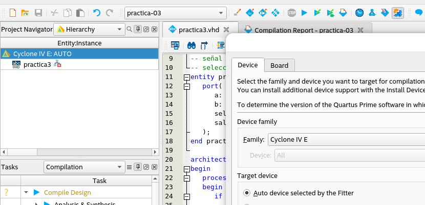
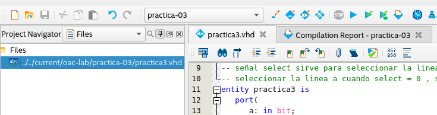
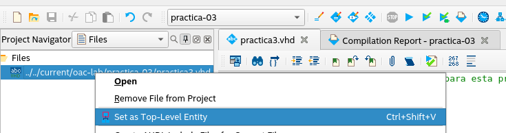
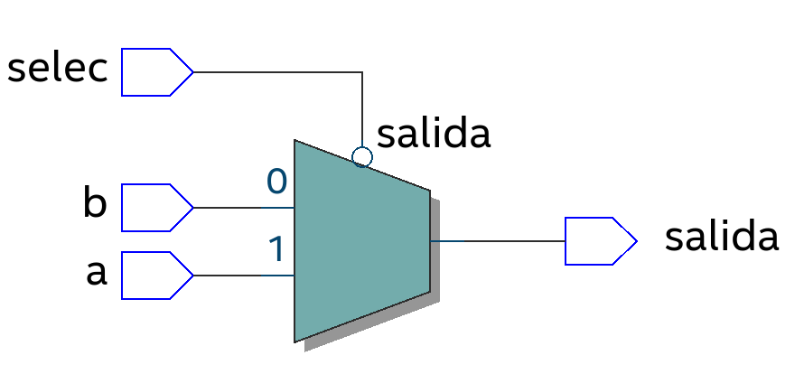
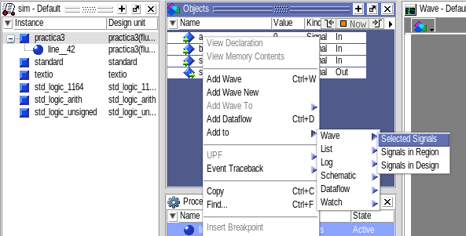
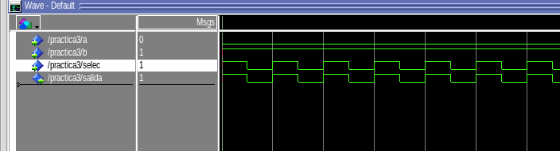

## Practica 03

### Objetivo

   Simular un programa en VHDL utilizando el software Quartus II

### Desarrollo

##### 1. Crear un proyecto con el nombre practica-3.

Se crea un proyecto nuevo con el nombre **practica-03** con el dispositivo objetivo en auto.



##### 2. Crear un archivo VHDL

Se crea el archivo **practica3.vhd**



##### 3. Se describe el siguiente hardware

```vhdl
-- librerias, no necesarias tdavia para esta practica
library ieee;
use ieee.std_logic_1164.all;
use ieee.std_logic_unsigned.all;

-- los comentarios inician con dos guiones
-- multiplexor de dos lineas de emtrada ( a y b )
-- a una sola linea de salida tambien de un bit
-- señal select sirve para seleccionar la linea
-- seleccionar la linea a cuando select = 0 , seleccionar la linea b cuando select = 1
entity practica3 is
	port(
		a: in bit;
		b: in bit;
		selec: in bit;
		salida: out bit
	);
end practica3;

architecture comportamental of practica3 is
begin
	process (a, b, selec)
	begin 
		if ( selec = '0' ) then
			salida <= a;
		else
			salida <= b;
		end if;
	end process;
end comportamental;

architecture flujo1 of practica3 is
signal nosel, ax, bx: bit;
	begin nosel <= not selec;
	ax <= a and nosel;
	bx <= b and selec;
	salida <= ax OR bx;
end flujo1;

architecture flujo2 of practica3 is
begin
	salida <= a when selec='0' else b;
end flujo2;
```


##### 4. Compilación

Se define a práctica3.vhd como top level entity



RTL



##### 5. Simulación

Agregamos al waveform las señales de interés. En este caso todas.



Configuramos las señales de la siguiente forma

| Señal | Configuración              |
| ----- | -------------------------- |
| a     | 0                          |
| b     | 1                          |
| sel   | oscilando entre 0 y 1 cada |

Y ejecutamos la simulación



Observamos el resultado esperado, según cambia el selector, se cambia entre la señal A en bajo y la señal B en alto.

### Conclusiones

Se ha podido observar que tenemos dos opciones principales para generar descripción de circuitos en Quartus II.

- Mediante diagramas esquemáticos

- Mediante lenguaje VHDL/Verilog

Siendo el uso de un lenguaje de descripción de hardware una opción mas adecuada para flujos de trabajo compartidos. pues al ser texto, es posible usar herramientas de control de versiones como GIT. Y en la era de la inteligencia artificial, es mas fácil que nos asista si la descripción del hardware es en texto.


